# uni-book-store — backend service

Spring Boot (Java 25, Gradle) backend for the uni-book-store project.
CI/CD lives in [`.github/workflows/ci.yml`](.github/workflows/ci.yml); Kubernetes
manifests live in [`k8s/`](k8s/).

---

## Lab 3 — Deployment to Kubernetes (minikube)

The backend is described with a set of Kubernetes manifests and deployed to a
local **minikube** cluster. PostgreSQL runs in-cluster (with a
PersistentVolumeClaim); Keycloak is **not** required to start the app (the JWT
decoder is lazy), so public endpoints (`/actuator/**`, `/swagger-ui/**`) work
without it.

### Objects (one file per object in `k8s/`)

| File | Object | Purpose |
|------|--------|---------|
| `00-namespace.yaml` | Namespace `uni-book-store` | isolates all lab objects |
| `01-backend-configmap.yaml` | ConfigMap `backend-config` | non-sensitive config (env vars) |
| `02-backend-secret.yaml` | Secret `backend-secret` | DB password (demo value) |
| `03-postgre-pvc.yaml` | PersistentVolumeClaim `postgres-pvc` | durable storage for PostgreSQL |
| `04-postgres-deployment.yaml` | Deployment `postgres` | stateful DB component |
| `05-postgre-service.yaml` | Service `postgres` (ClusterIP) | internal DB access |
| `06-backend-deployment.yaml` | Deployment `backend` | 2 replicas, probes, resources |
| `07-backend-service.yaml` | Service `backend` (NodePort 30080) | in-cluster + host access |
| `08-backend-ingress.yaml` | Ingress `backend` | host access via nginx ingress |

### Configuration parameters

**ConfigMap `backend-config`** (injected into the backend as env vars):

| Key | Value | Used for |
|-----|-------|----------|
| `DB_HOST` | `postgres` | `spring.datasource.url` host |
| `DB_PORT` | `5432` | `spring.datasource.url` port |
| `KEYCLOAK_URI` | `http://keycloak:8080` | OAuth2 issuer base |
| `POSTGRES_DB` | `mydatabase` | DB name (app + postgres) |
| `POSTGRES_USER` | `myuser` | DB user (app + postgres) |
| `MANAGEMENT_ENDPOINTS_WEB_EXPOSURE_INCLUDE` | `health,info` | actuator exposure |
| `MANAGEMENT_ENDPOINT_HEALTH_PROBES_ENABLED` | `true` | liveness/readiness groups |
| `MANAGEMENT_INFO_ENV_ENABLED` | `true` | expose version in `/actuator/info` |

**Secret `backend-secret`** (base64-encoded at rest; demo values, not real):

| Key | Purpose |
|-----|---------|
| `SPRING_DATASOURCE_PASSWORD` | overrides `spring.datasource.password` |
| `POSTGRES_PASSWORD` | initialises the PostgreSQL container |

### Prerequisites

```bash
# minikube + kubectl (macOS / Homebrew)
brew install minikube kubernetes-cli
```

### 1. Build the two image versions (no `latest` tag)

```bash
docker build --build-arg APP_VERSION=1.0.0 -t uni-book-store-backend:1.0.0 .
docker build --build-arg APP_VERSION=1.1.0 -t uni-book-store-backend:1.1.0 .
```

### 2. Start the cluster and load the images

```bash
minikube start --driver=docker
minikube addons enable metrics-server
minikube addons enable ingress

minikube image load uni-book-store-backend:1.0.0
minikube image load uni-book-store-backend:1.1.0
```

### 3. Deploy — a single command from the directory

```bash
kubectl apply -f k8s/
kubectl -n uni-book-store rollout status deploy/postgres
kubectl -n uni-book-store rollout status deploy/backend
```

### 4. Open the app

```bash
# NodePort via minikube (keep the terminal open — docker driver on macOS):
minikube service backend -n uni-book-store

# or a stable port-forward:
kubectl -n uni-book-store port-forward svc/backend 8088:80
# then open: http://localhost:8088/swagger-ui/index.html
#            http://localhost:8088/actuator/info   -> {"app":{"version":"1.0.0"}}
```

Ingress (optional): add `"$(minikube ip) uni-book-store.local"` to `/etc/hosts`
and open `http://uni-book-store.local/` (run `minikube tunnel` if needed).

### 5. Lifecycle management

```bash
# self-healing
kubectl -n uni-book-store delete pod -l app=backend --field-selector=status.phase=Running | head -1

# scaling
kubectl -n uni-book-store scale deploy/backend --replicas=4
kubectl -n uni-book-store get endpoints backend

# rolling update 1.0.0 -> 1.1.0
kubectl -n uni-book-store set image deploy/backend backend=uni-book-store-backend:1.1.0
kubectl -n uni-book-store rollout status deploy/backend

# history + rollback
kubectl -n uni-book-store rollout history deploy/backend
kubectl -n uni-book-store rollout undo deploy/backend --to-revision=1
```

### 6. Diagnostics (ImagePullBackOff)

```bash
kubectl -n uni-book-store set image deploy/backend backend=uni-book-store-backend:9.9.9-does-not-exist
kubectl -n uni-book-store get pods -l app=backend                 # ImagePullBackOff
kubectl -n uni-book-store describe pod <pod>                      # Events -> cause
kubectl -n uni-book-store logs <healthy-pod>
kubectl -n uni-book-store exec -it <healthy-pod> -- sh            # interactive shell
# fix:
kubectl -n uni-book-store set image deploy/backend backend=uni-book-store-backend:1.0.0
```

### Tear down

```bash
kubectl delete -f k8s/
minikube stop   # or: minikube delete
```

---

# Звіт про виконання (пункти 5–7)

Скриншоти команд та Kubernetes Dashboard, що підтверджують виконання кожного пункту.

## Пункт 5 — Розгортання застосунку

### 5a. Застосування всіх маніфестів однією командою

Спершу суха перевірка (`--dry-run=client`), потім реальне застосування `kubectl apply -f k8s/` — усі 9 об'єктів створено однією командою з каталогу.

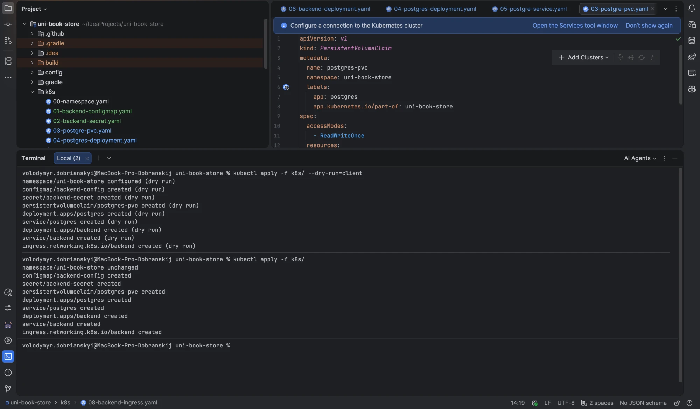

Команда ідемпотентна: повторний `apply` не перестворює об'єкти, а лише оновлює змінені (`unchanged` / `configured`).

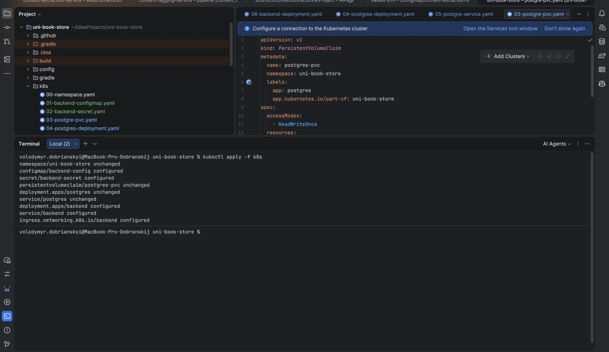

### 5b. Перелік створених об'єктів (поди, Deployment, ReplicaSet, Service)

```bash
kubectl get pods
kubectl get deploy
kubectl get replicaset
kubectl get service
```

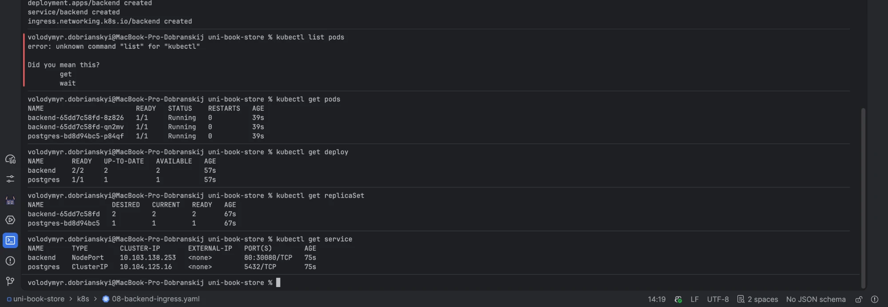

Ті самі об'єкти в Kubernetes Dashboard (поди з образом `uni-book-store-backend:1.0.0`, споживання CPU/пам'яті завдяки metrics-server):

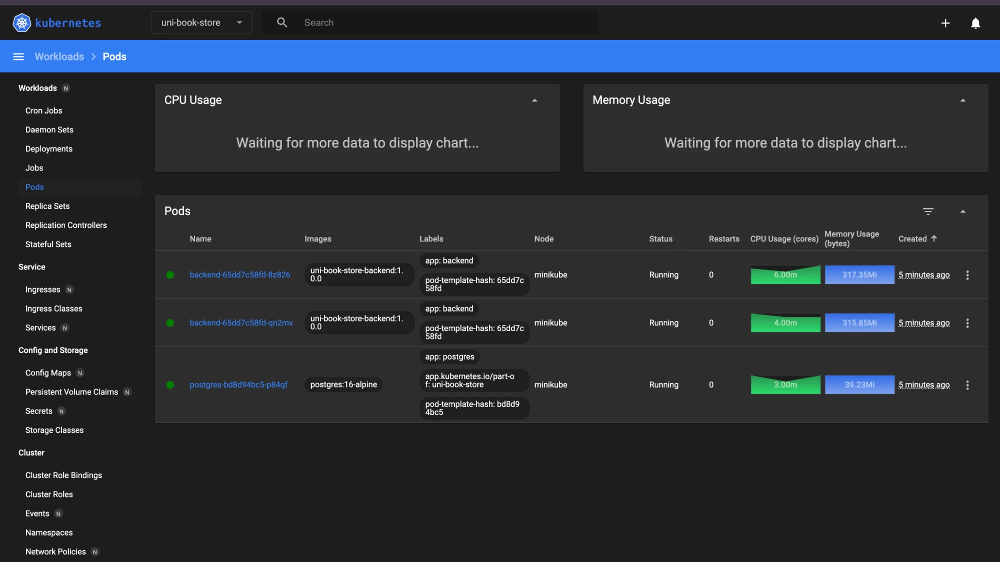

### 5c. Відкриття застосунку з хоста

Доступ через `kubectl port-forward` (надійно на docker-драйвері macOS), далі `http://localhost:8080/swagger-ui/index.html` та `/actuator/info`.

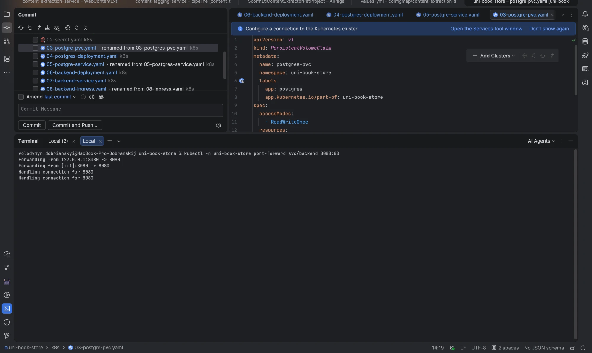

### 5d. ConfigMap і Secret справді потрапили в контейнер

Значення з ConfigMap `backend-config`, видимі в Dashboard (ті самі, що читає застосунок):

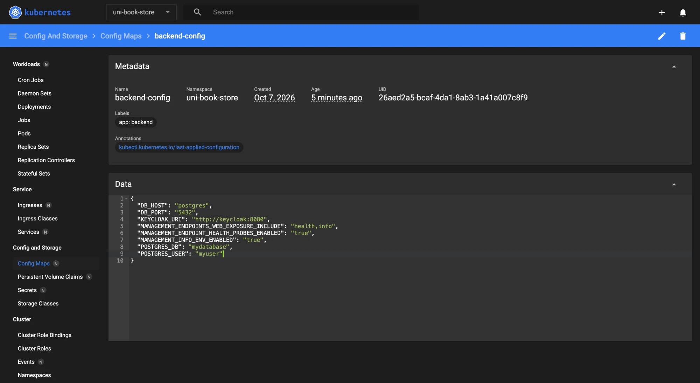

Додатково перевіряється зсередини контейнера:

```bash
kubectl -n uni-book-store exec deploy/backend -- \
  printenv DB_HOST DB_PORT KEYCLOAK_URI SPRING_DATASOURCE_PASSWORD INFO_APP_VERSION
```

## Пункт 6 — Керування життєвим циклом

### 6a. Самовідновлення

```bash
kubectl -n uni-book-store delete pod -l app=backend --field-selector=status.phase=Running | head -1
kubectl -n uni-book-store get pods -w
```

Після видалення пода ReplicaSet негайно створює новий, щоб відповідати бажаній кількості реплік (2).

### 6b. Масштабування

```bash
kubectl -n uni-book-store scale deploy/backend --replicas=4
kubectl -n uni-book-store get endpoints backend
```

Усі репліки додаються до endpoints Service, між якими балансується трафік.

### 6c. Оновлення (rolling update 1.0.0 → 1.1.0)

Зміна образу запускає поступову заміну подів. Нова ReplicaSet піднімається, стара «здувається» до нуля:

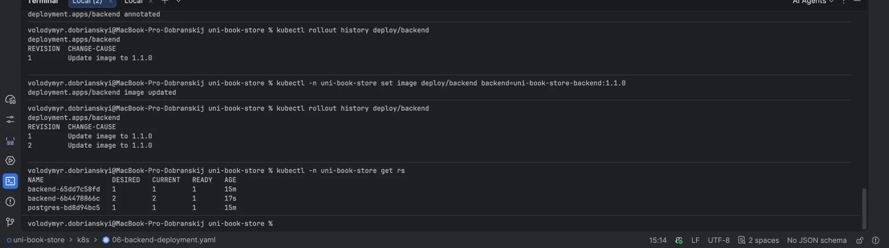

Процес rolling update у маніфесті й через `get rs` (стара RS → 0, нова → 2):

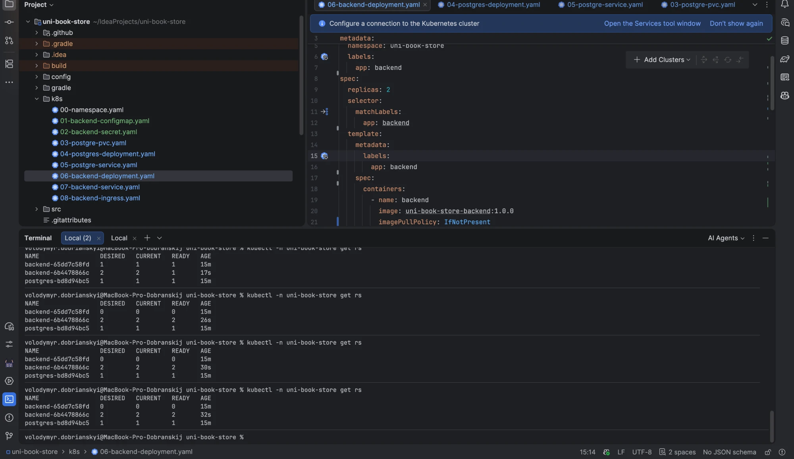

Той самий процес у Dashboard — одночасно `Pending` (новий), `Terminating` (старий) і `Running` (решта), тобто **нуль простою**:

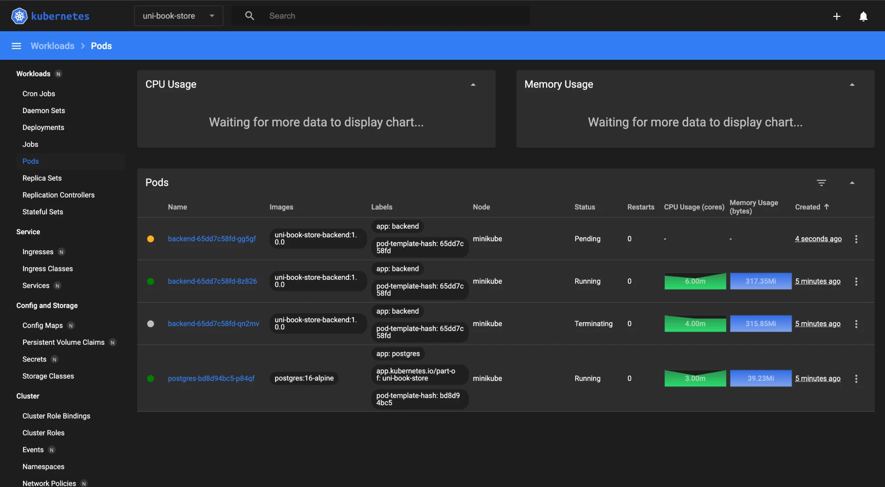

### 6d. Історія оновлень та відкат

```bash
kubectl -n uni-book-store rollout history deploy/backend
```

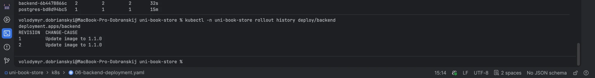

Відкат до попередньої ревізії (теж rolling update, без простою):

```bash
kubectl -n uni-book-store rollout undo deploy/backend --to-revision=1
```

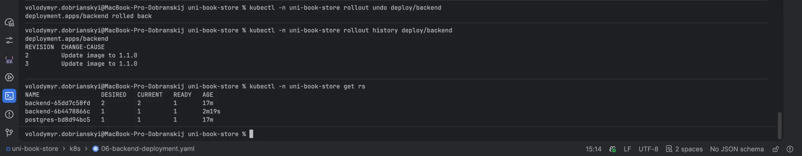

## Пункт 7 — Діагностика

### 7a. Навмисна помилка → ImagePullBackOff

```bash
kubectl -n uni-book-store set image deploy/backend backend=uni-book-store-backend:9.9.9-does-not-exist
```

Новий под проходить init-контейнер і застрягає на завантаженні неіснуючого образу:

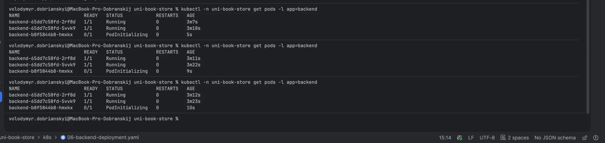

За кілька секунд — стан `ImagePullBackOff` (старі поди лишаються `Running` — застосунок не впав):

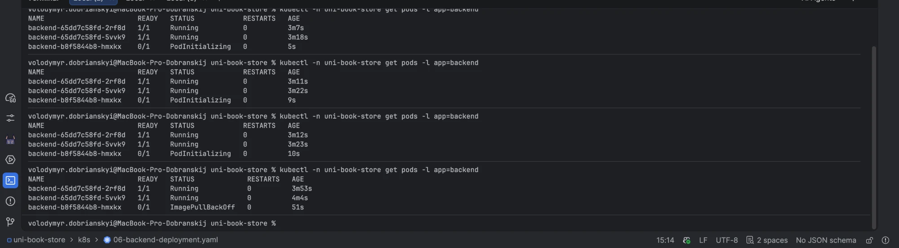

### 7b. Пошук причини (опис пода + Events)

```bash
kubectl -n uni-book-store describe pod <pod>
```

У секції Events — точна причина: `repository does not exist` для тега `9.9.9-does-not-exist`.

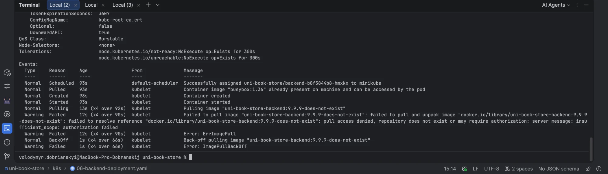

### 7c. Логи контейнера та вхід у контейнер

Логи здорового пода (Spring Boot стартував, Tomcat на 8080):

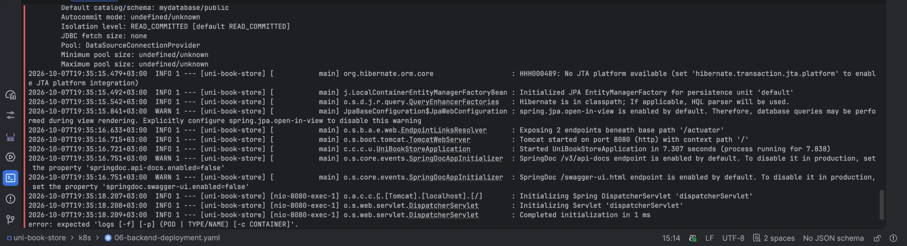

Інтерактивний вхід у контейнер:

```bash
kubectl -n uni-book-store exec -it <healthy-pod> -- sh
```

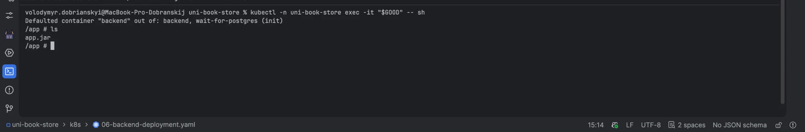

### 7d. Виправлення та повернення в робочий стан

```bash
kubectl -n uni-book-store set image deploy/backend backend=uni-book-store-backend:1.0.0
kubectl -n uni-book-store rollout status deploy/backend
```

Валідний образ повернуто, rollout завершився успішно, усі поди `Running 1/1`:

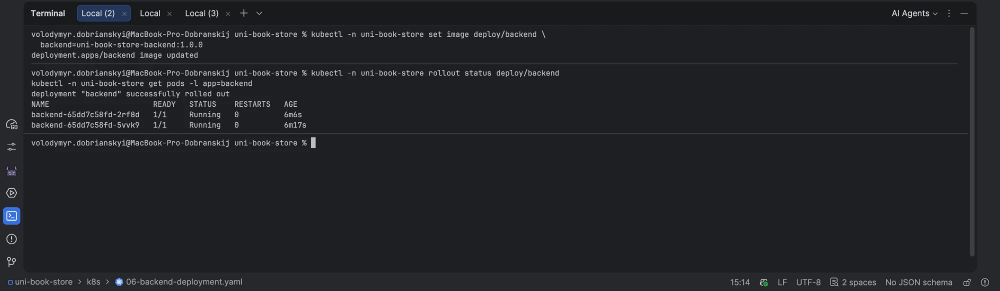

---

## Повний стек у кластері: Keycloak + фронтенд (Варіант Б)

Розширення лаби: до backend + Postgres додано **Keycloak** (зі своєю БД) і **React-фронтенд**,
щоб працював реальний OAuth-логін з браузера.

### Архітектура

```
Браузер
  ├─ http://uni-book-store.local/        → Ingress → frontend (nginx+SPA)
  │                                         └─ /api → proxy → backend:8080
  └─ http://keycloak.local/              → Ingress → keycloak:8080
backend  → валідує JWT, issuer = http://keycloak.local/realms/uni-book-store
```

**Ключ Варіанта Б:** і браузер, і бекенд звертаються до Keycloak за одним хостом
`keycloak.local`, тож `issuer` у токені збігається з очікуваним бекендом. Усередині
пода бекенда `keycloak.local` резолвиться у вузол (`hostAliases`), де ingress слухає :80.

### Додаткові об'єкти (`k8s/09…19`)

| Файли | Об'єкт |
|-------|--------|
| `09-keycloak-secret.yaml` | Secret (паролі admin + БД Keycloak) |
| `10…12` | Keycloak Postgres: PVC + Deployment + Service |
| `13-keycloak-realm-configmap.yaml` | realm `uni-book-store` (клієнт + ролі + тестовий юзер) |
| `14…16` | Keycloak: Deployment (`--import-realm`) + Service + Ingress `keycloak.local` |
| `17…19` | Frontend: Deployment + Service + Ingress `uni-book-store.local` |

### Тестовий користувач

| Логін | Пароль | Ролі |
|-------|--------|------|
| `testuser` | `password` | `ADMIN`, `USER` |

Адмін-консоль Keycloak: `http://keycloak.local/admin` (admin / admin).

### Запуск

```bash
# 1. /etc/hosts — усі хости на IP вузла (перевірте: minikube ip)
echo "$(minikube ip) uni-book-store.local keycloak.local api.uni-book-store.local" | sudo tee -a /etc/hosts

# 2. Якщо `minikube ip` != 192.168.49.2 — підправте hostAliases у 06-backend-deployment.yaml

# 3. Зібрати та завантажити образ фронтенду (без VITE_API_URL -> same-origin /api)
docker build \
  --build-arg VITE_OIDC_AUTHORITY=http://keycloak.local/realms/uni-book-store \
  --build-arg VITE_OIDC_CLIENT_ID=uni-book-store-client \
  -t uni-book-store-frontend:1.0.0 \
  ~/IdeaProjects/ui-book-store-client
minikube image load uni-book-store-frontend:1.0.0

# 4. Застосувати все
kubectl apply -f k8s/
kubectl -n uni-book-store rollout status deploy/keycloak --timeout=300s
kubectl -n uni-book-store rollout status deploy/backend
kubectl -n uni-book-store rollout status deploy/frontend

# 5. Тунель до ingress (тримати відкритим, окремий термінал)
minikube tunnel
```

Відкрити: **http://uni-book-store.local/** → увійти як `testuser` / `password`.
