# Лабораторна робота №3 — Звіт про виконання

Розгортання backend-сервісу **uni-book-store** у локальному кластері Kubernetes (minikube).
Повний опис маніфестів та порядку розгортання — у [головному README](../../README.md).
Нижче — підтвердження виконання пунктів **5–7** командами та Kubernetes Dashboard.

---

## Пункт 5 — Розгортання застосунку

### 5a. Застосування всіх маніфестів однією командою

Спершу суха перевірка (`--dry-run=client`), потім реальне застосування `kubectl apply -f k8s/` — усі 9 об'єктів створено однією командою з каталогу.

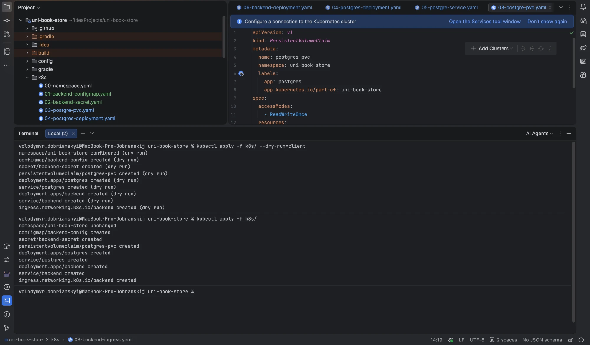

Команда ідемпотентна: повторний `apply` не перестворює об'єкти, а лише оновлює змінені (`unchanged` / `configured`).

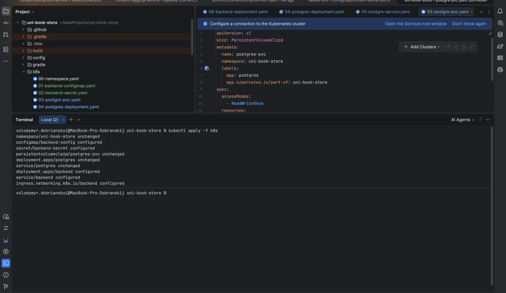

### 5b. Перелік створених об'єктів (поди, Deployment, ReplicaSet, Service)

```bash
kubectl get pods
kubectl get deploy
kubectl get replicaset
kubectl get service
```

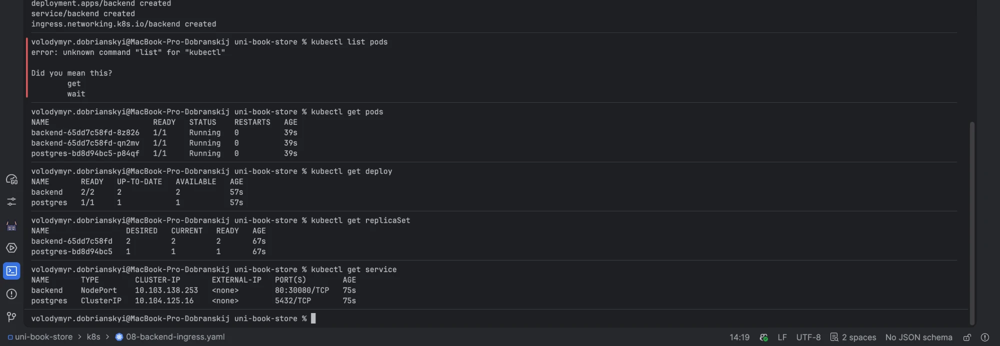

Ті самі об'єкти в Kubernetes Dashboard (поди з образом `uni-book-store-backend:1.0.0`, споживання CPU/пам'яті завдяки metrics-server):

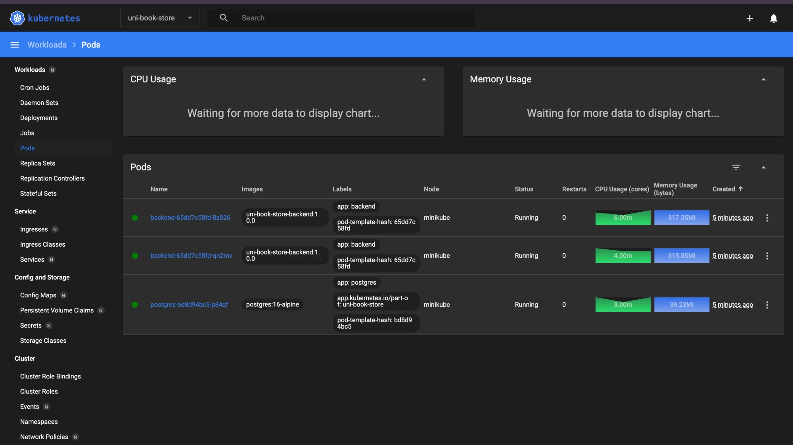

### 5c. Відкриття застосунку з хоста

Доступ через `kubectl port-forward` (надійно на docker-драйвері macOS), далі `http://localhost:8080/swagger-ui/index.html` та `/actuator/info`.

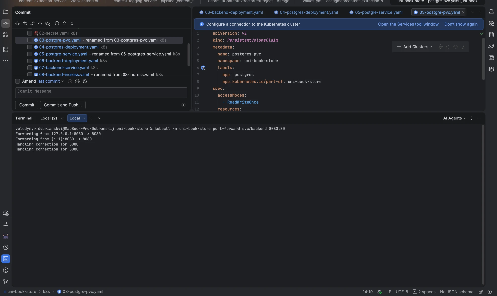

### 5d. ConfigMap і Secret справді потрапили в контейнер

Значення з ConfigMap `backend-config`, видимі в Dashboard (ті самі, що читає застосунок):

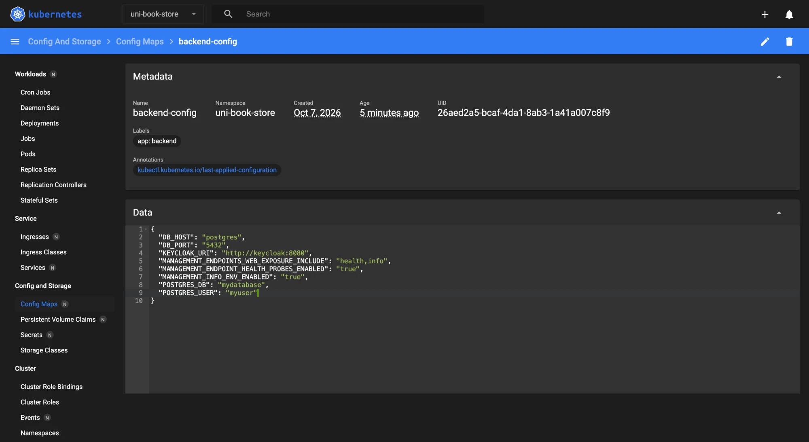

Додатково перевіряється зсередини контейнера:

```bash
kubectl -n uni-book-store exec deploy/backend -- \
  printenv DB_HOST DB_PORT KEYCLOAK_URI SPRING_DATASOURCE_PASSWORD INFO_APP_VERSION
```

---

## Пункт 6 — Керування життєвим циклом

### 6a. Самовідновлення

```bash
kubectl -n uni-book-store delete pod -l app=backend --field-selector=status.phase=Running | head -1
kubectl -n uni-book-store get pods -w
```

Після видалення пода ReplicaSet негайно створює новий, щоб відповідати бажаній кількості реплік (2).

### 6b. Масштабування

```bash
kubectl -n uni-book-store scale deploy/backend --replicas=4
kubectl -n uni-book-store get endpoints backend
```

Усі репліки додаються до endpoints Service, між якими балансується трафік.

### 6c. Оновлення (rolling update 1.0.0 → 1.1.0)

Зміна образу запускає поступову заміну подів. Нова ReplicaSet піднімається, стара «здувається» до нуля:

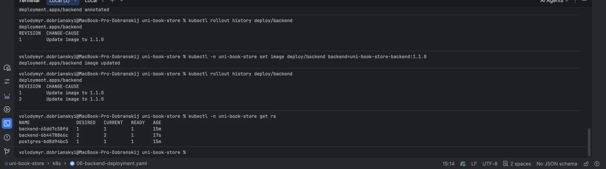

Процес rolling update у маніфесті й через `get rs` (стара RS → 0, нова → 2):

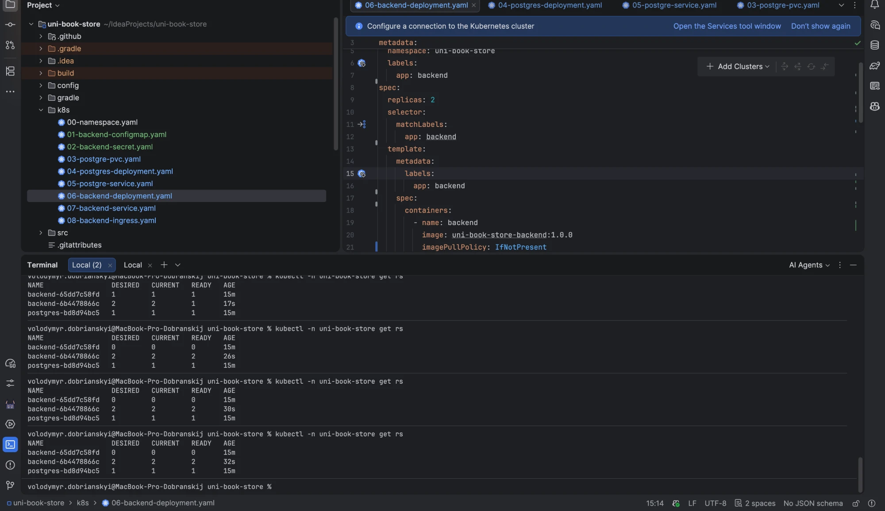

Той самий процес у Dashboard — одночасно `Pending` (новий), `Terminating` (старий) і `Running` (решта), тобто **нуль простою**:

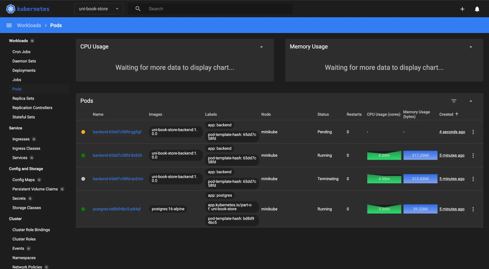

### 6d. Історія оновлень та відкат

```bash
kubectl -n uni-book-store rollout history deploy/backend
```

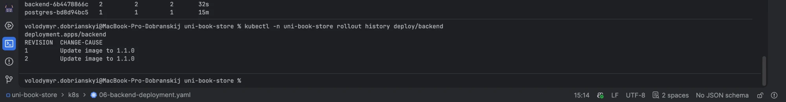

Відкат до попередньої ревізії (теж rolling update, без простою):

```bash
kubectl -n uni-book-store rollout undo deploy/backend --to-revision=1
```

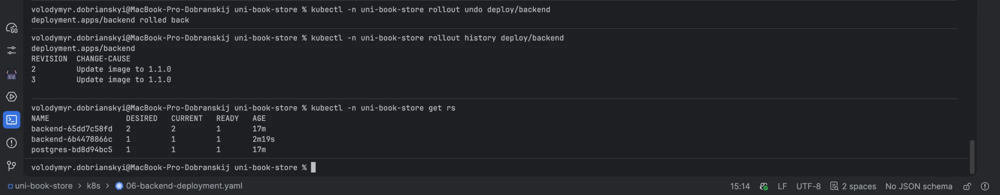

---

## Пункт 7 — Діагностика

### 7a. Навмисна помилка → ImagePullBackOff

```bash
kubectl -n uni-book-store set image deploy/backend backend=uni-book-store-backend:9.9.9-does-not-exist
```

Новий под проходить init-контейнер і застрягає на завантаженні неіснуючого образу:

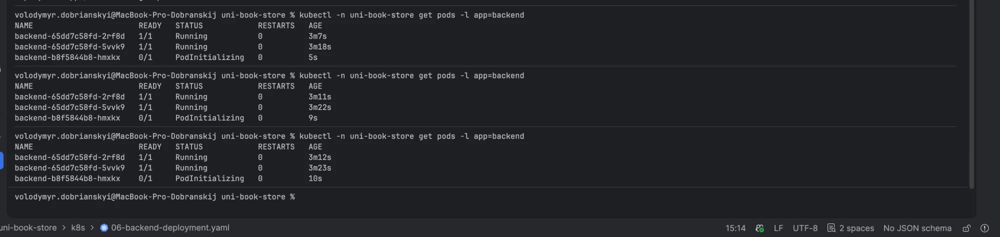

За кілька секунд — стан `ImagePullBackOff` (старі поди лишаються `Running` — застосунок не впав):

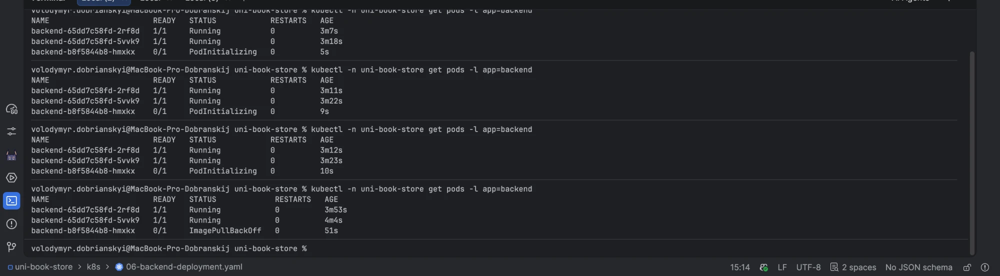

### 7b. Пошук причини (опис пода + Events)

```bash
kubectl -n uni-book-store describe pod <pod>
```

У секції Events — точна причина: `repository does not exist` для тега `9.9.9-does-not-exist`.

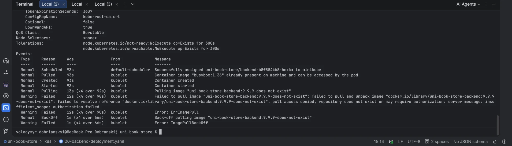

### 7c. Логи контейнера та вхід у контейнер

Логи здорового пода (Spring Boot стартував, Tomcat на 8080):

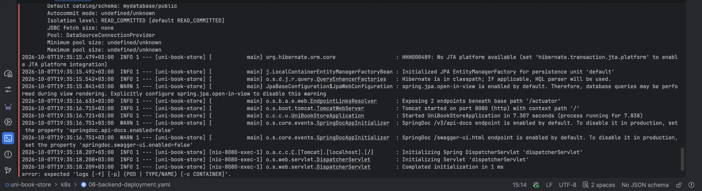

Інтерактивний вхід у контейнер:

```bash
kubectl -n uni-book-store exec -it <healthy-pod> -- sh
```

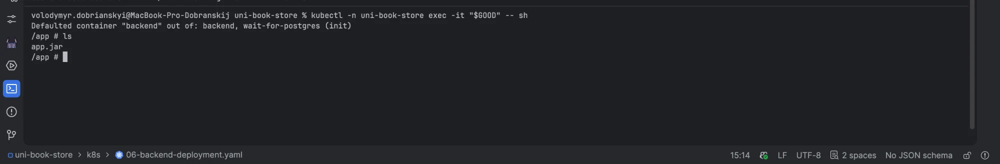

### 7d. Виправлення та повернення в робочий стан

```bash
kubectl -n uni-book-store set image deploy/backend backend=uni-book-store-backend:1.0.0
kubectl -n uni-book-store rollout status deploy/backend
```

Валідний образ повернуто, rollout завершився успішно, усі поди `Running 1/1`:

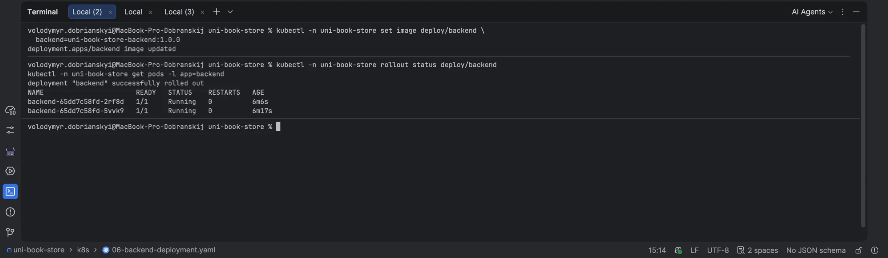
