# Лабораторна робота №4 — Звіт про виконання

Пакування застосунку **uni-book-store** у Helm-чарт.
Опис чарта та параметрів values — у [helm/README.md](../../helm/README.md).
Нижче — підтвердження виконання пунктів **6–9**.

---

## Пункт 6 — Два середовища

Файли [values-dev.yaml](../../helm/values-dev.yaml) і [values-prod.yaml](../../helm/values-prod.yaml)
відрізняються реплікою, ресурсами, тегом образу та Ingress.

**6b — різниця без встановлення в кластер:**
```bash
helm template uni helm/ -f helm/values-dev.yaml  > dev.yaml
helm template uni helm/ -f helm/values-prod.yaml > prod.yaml
diff dev.yaml prod.yaml
```
Результат: dev = 6 обʼєктів, prod = 8 (prod додає Ingress + PVC); репліки 1↔3; образ 1.0.0↔1.1.0.

**6c — пріоритет значень:** `values.yaml` < `-f файл` < `--set` (нижчий → вищий).
Перевірено: `-f values-prod.yaml` → replicas 3; `+ --set backend.replicaCount=5` → 5.

---

## Пункт 7 — Перевірка та встановлення чарта

### 7a. Перевірка чарта на помилки (`helm lint`)
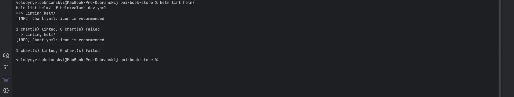

### 7b. Перегляд згенерованих маніфестів (`helm template`) і порівняння з Lab 3
Той самий набір обʼєктів, що в Lab 3; різниця — імена з префіксом релізу.
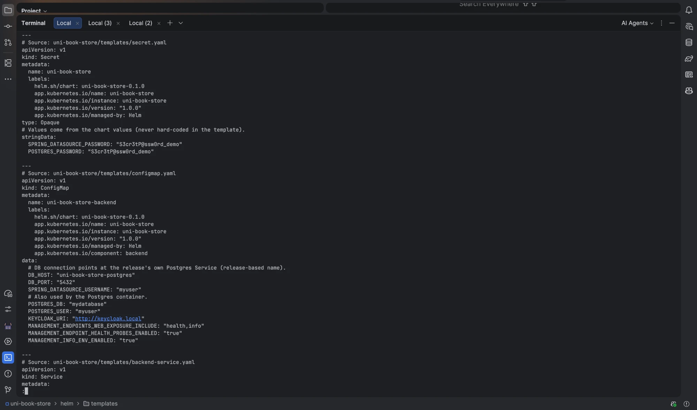

### 7c. Встановлення релізу у власний namespace
```bash
helm install uni-book-store helm/ -f helm/values-dev.yaml -n uni-book-store --create-namespace
```
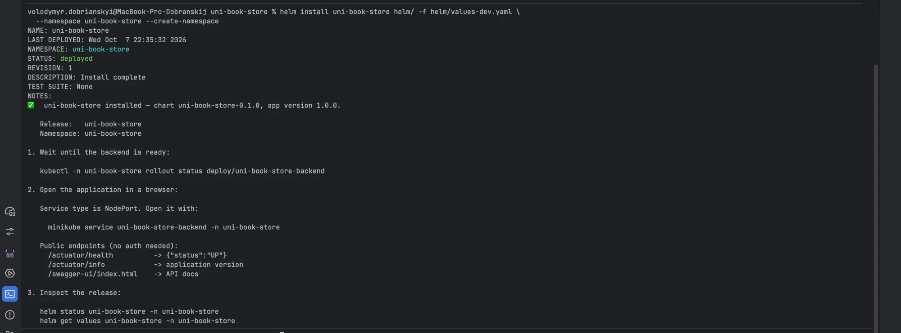
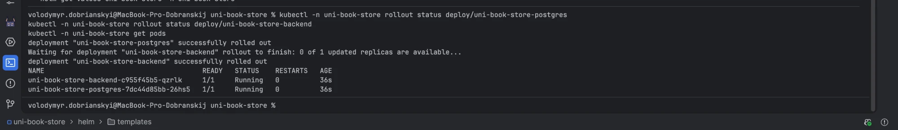

### 7d. Перелік релізів, статус і значення
```bash
helm list -n uni-book-store
helm status uni-book-store -n uni-book-store
helm get values uni-book-store -n uni-book-store --all
```
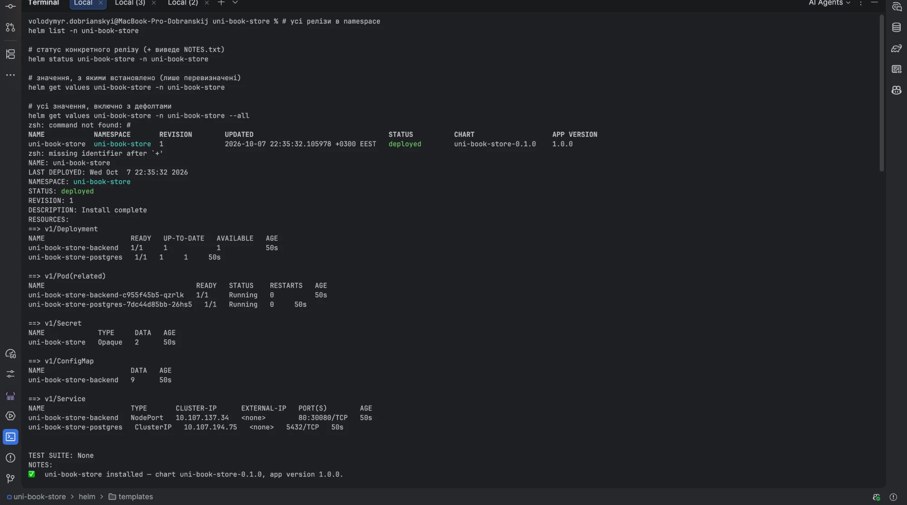
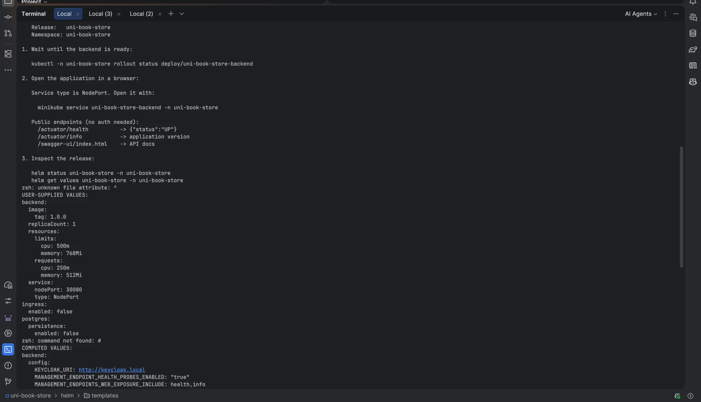

### 7e. Де Helm зберігає стан релізу
Стан кожної ревізії — у **Secret типу `helm.sh/release.v1`** (`sh.helm.release.v1.<реліз>.v<N>`).
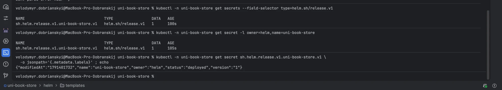

---

## Пункт 8 — Життєвий цикл релізу

### 8a. Оновлення тега образу через `--set` (ревізія 2)
```bash
helm upgrade uni-book-store helm/ -f helm/values-dev.yaml --set backend.image.tag=1.1.0 -n uni-book-store
```
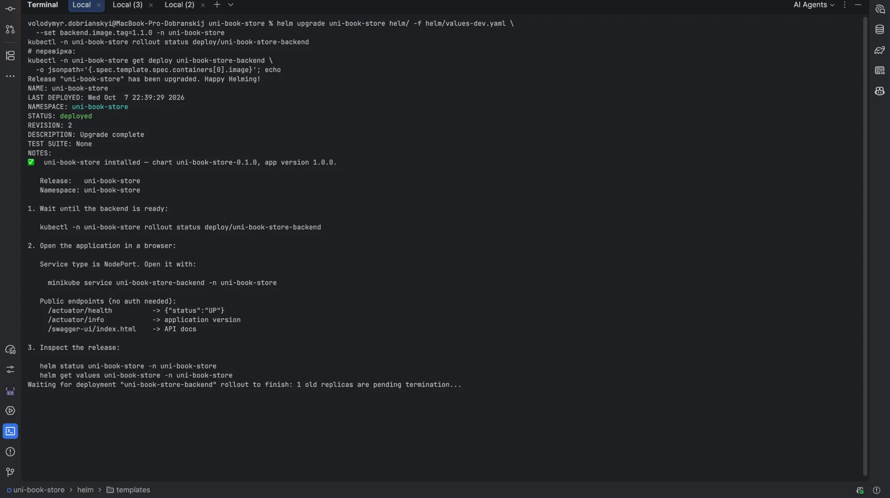

### 8b. Оновлення файлом значень іншого середовища (ревізія 3)
```bash
helm upgrade uni-book-store helm/ -f helm/values-prod.yaml -n uni-book-store
```
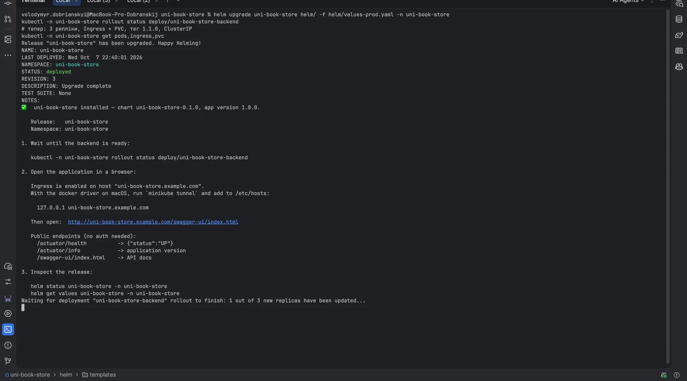

### 8c. Історія ревізій
rev1 — install (dev); rev2 — `--set` тег 1.1.0; rev3 — `-f values-prod.yaml`.
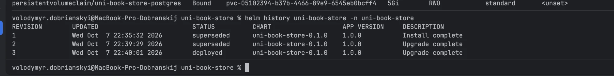

### 8d. Відкат і його відображення в історії
```bash
helm rollback uni-book-store 1 -n uni-book-store
```
Зʼявляється нова ревізія (копія rev1), образ знову 1.0.0.
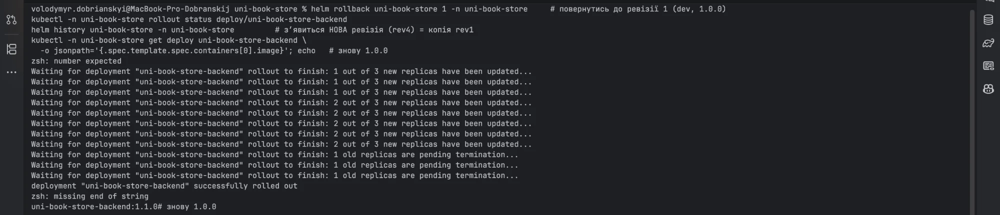

### 8e. Видалення релізу однією командою
```bash
helm uninstall uni-book-store -n uni-book-store
```
У namespace не лишається обʼєктів релізу (лише службовий `kube-root-ca.crt`).
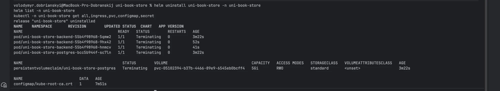

---

## Пункт 9 — Завдання на вибір: 9a (залежність від стороннього чарта)

Додано залежність від офіційного **bitnami/postgresql** у `Chart.yaml`
(умова `postgresql.enabled`), налаштовується через значення батьківського чарта.

```bash
helm dependency update helm/
helm dependency list helm/
helm install uni-book-store helm/ -n uni-book-store --create-namespace \
  --set postgresql.enabled=true --set postgresql.auth.username=myuser
```
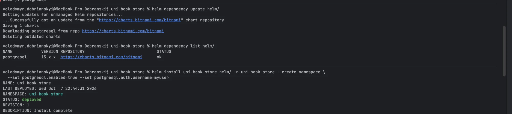
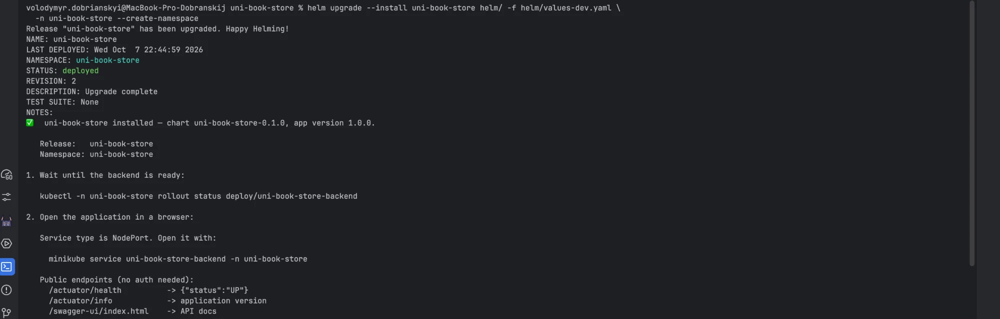

> Додатково досліджено `helm test` (варіант 9b): без визначених тест-хуків команда
> повертає `TEST SUITE: None` — тому для здачі обрано саме **9a**.
> 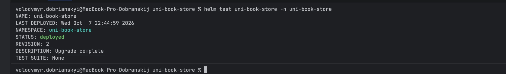
