# uni-book-store — Helm chart

Helm-чарт для backend-сервісу **uni-book-store** (Spring Boot) та його бази даних
PostgreSQL. Переписаний з Kubernetes-маніфестів лабораторної №3, параметризований
для кількох середовищ (dev / prod).

## version vs appVersion

Два **незалежні** номери в `Chart.yaml`:

| Поле | Що версіонує | Значення |
|------|--------------|----------|
| `version` | сам **чарт** (пакування: шаблони, values) — підіймається при зміні чарта | `0.1.0` |
| `appVersion` | **застосунок**, який чарт розгортає (backend-образ) | `1.0.0` |

Приклад: правка шаблону без зміни коду → `version 0.1.0 → 0.2.0`, `appVersion` незмінний.
Нова версія backend → `appVersion 1.0.0 → 1.1.0`. `appVersion` також використовується як
**дефолтний тег образу** (`backend.image.tag` = `.Chart.AppVersion`, якщо порожній).

## Параметри values

| Параметр | Опис | Default (dev) |
|----------|------|---------------|
| `backend.replicaCount` | кількість реплік backend | `1` |
| `backend.image.repository` | репозиторій образу backend | `uni-book-store-backend` |
| `backend.image.tag` | тег образу (порожній → `appVersion`) | `""` → `1.0.0` |
| `backend.image.pullPolicy` | політика завантаження образу | `IfNotPresent` |
| `backend.containerPort` | порт контейнера backend | `8080` |
| `backend.service.type` | тип Service backend | `NodePort` |
| `backend.service.port` | порт Service backend | `80` |
| `backend.service.nodePort` | фіксований NodePort (порожній → авто) | `30080` |
| `backend.resources` | requests/limits CPU та памʼяті | `250m/512Mi → 500m/768Mi` |
| `backend.config.KEYCLOAK_URI` | базовий URL Keycloak (issuer) | `http://keycloak.local` |
| `backend.config.MANAGEMENT_*` | налаштування actuator (health/info/probes) | див. values.yaml |
| `postgres.image.repository` | образ PostgreSQL | `postgres` |
| `postgres.image.tag` | тег образу PostgreSQL | `16-alpine` |
| `postgres.service.port` | порт БД | `5432` |
| `postgres.auth.database` | імʼя БД | `mydatabase` |
| `postgres.auth.username` | користувач БД | `myuser` |
| `postgres.auth.password` | пароль БД (demo, не реальний) | `S3cr3tP@ssw0rd_demo` |
| `postgres.resources` | requests/limits для БД | `100m/128Mi → 500m/256Mi` |
| `postgres.persistence.enabled` | **прапорець** PVC (durable storage) | `true` |
| `postgres.persistence.size` | розмір PVC | `1Gi` |
| `ingress.enabled` | **прапорець** Ingress | `true` |
| `ingress.className` | IngressClass | `nginx` |
| `ingress.host` | хост Ingress | `uni-book-store.local` |
| `ingress.path` / `ingress.pathType` | шлях / тип шляху | `/` / `Prefix` |
| `postgresql.enabled` | увімкнути залежний чарт PostgreSQL (bitnami, Задача 9a) | `false` |

> **Чутливі значення** (`postgres.auth.password`) беруться з values і потрапляють у Secret —
> у шаблонах паролів немає. Реальні паролі у файлах значень **не зберігаються**.

## Встановлення

### dev

```bash
helm install uni-book-store helm/ -f helm/values-dev.yaml \
  --namespace uni-book-store --create-namespace
```

Легке середовище: 1 репліка, образ `1.0.0`, Ingress вимкнено (доступ через NodePort /
`minikube service`), ефемерна БД.

### prod

```bash
helm install uni-book-store-prod helm/ -f helm/values-prod.yaml \
  --namespace uni-book-store-prod --create-namespace
```

Важче середовище: 3 репліки, образ `1.1.0`, Ingress увімкнено
(`uni-book-store.example.com`), ClusterIP, durable БД (PVC 5Gi).

### Пріоритет значень

```
values.yaml  <  -f файл  <  --set
(дефолти)       (середовище)   (точкове перевизначення)
```

Приклад: `helm install ... -f helm/values-prod.yaml --set backend.replicaCount=5`
→ `replicaCount = 5` (бо `--set` має найвищий пріоритет).

## Залежність (Задача 9a)

Чарт має необовʼязкову залежність від офіційного **bitnami/postgresql**
(`Chart.yaml → dependencies`, умова `postgresql.enabled`):

```bash
helm dependency update helm/     # завантажити залежність у helm/charts/
helm dependency list helm/
helm install uni-book-store helm/ -n uni-book-store --create-namespace \
  --set postgresql.enabled=true
```

Налаштовується через значення батьківського чарта (ключі `postgresql.*`).

## Життєвий цикл релізу

```bash
helm upgrade uni-book-store helm/ -f helm/values-dev.yaml --set backend.image.tag=1.1.0 -n uni-book-store
helm history  uni-book-store -n uni-book-store
helm rollback uni-book-store 1 -n uni-book-store
helm uninstall uni-book-store -n uni-book-store
```

---

## Підтвердження виконання (скриншоти)

### 7. Перевірка та встановлення чарта

**7a — `helm lint`:**

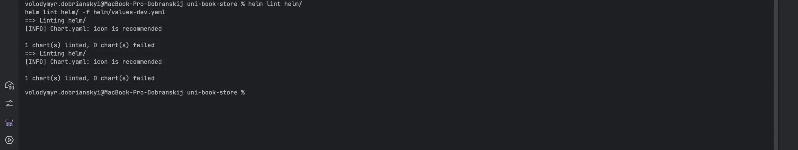

**7b — `helm template` (порівняння з Lab 3):**

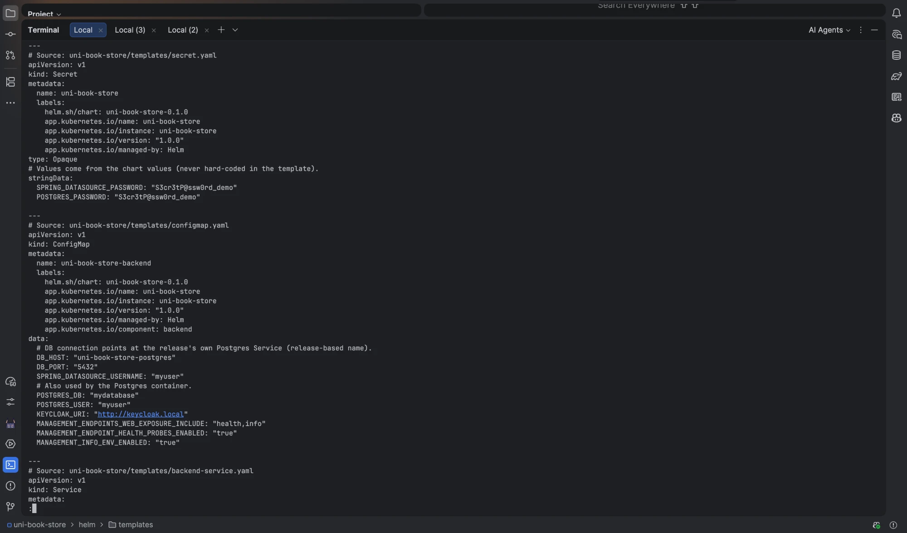

**7c — встановлення релізу + поди Running:**

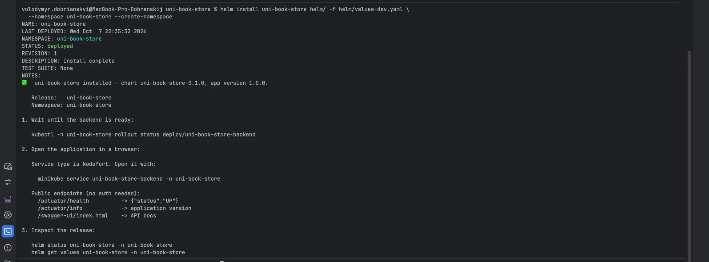
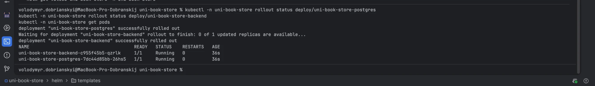

**7d — список/статус/значення релізу:**

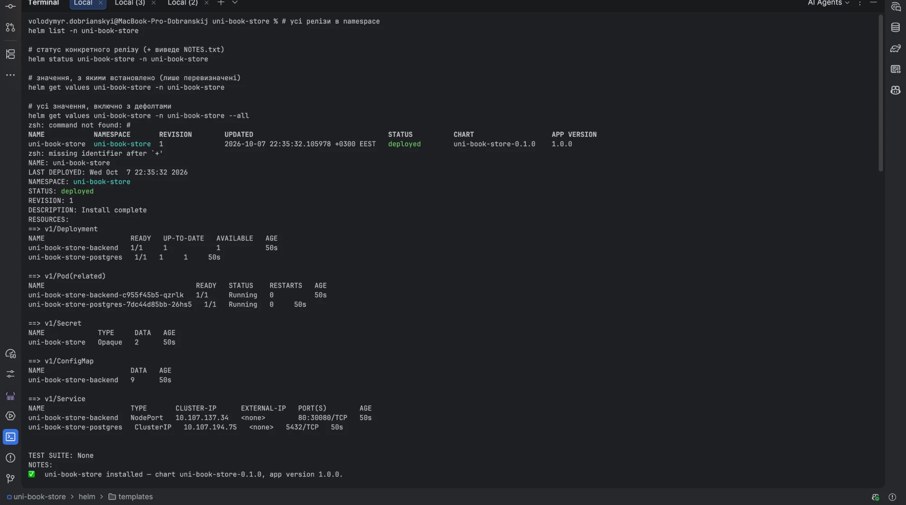
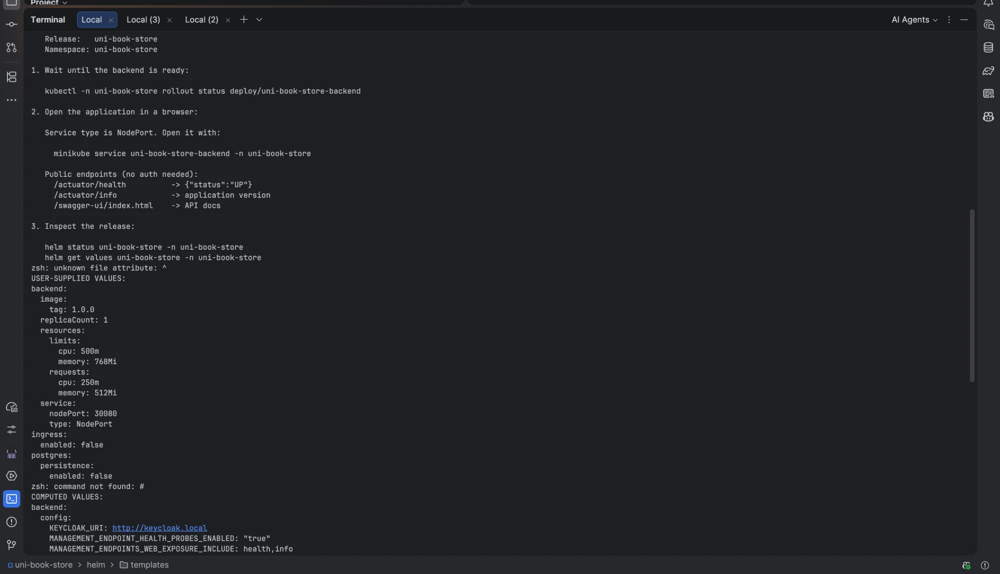

**7e — де Helm зберігає стан (Secret `helm.sh/release.v1`):**

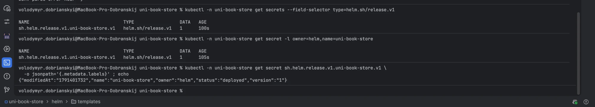

### 8. Життєвий цикл релізу

**8a — `--set` тег образу (ревізія 2):**

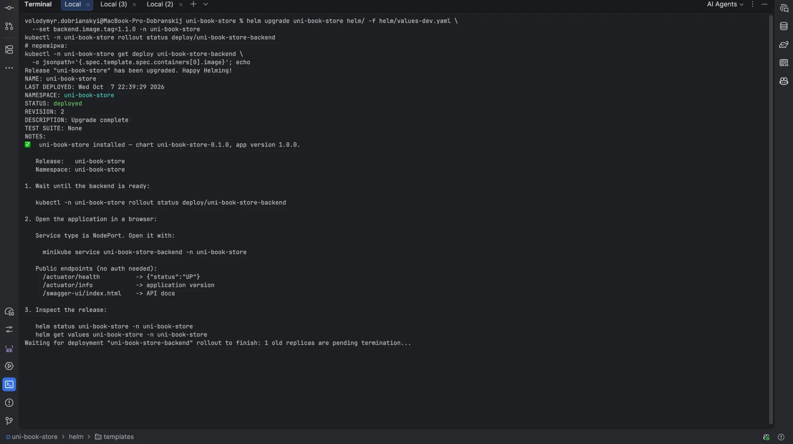

**8b — `-f values-prod.yaml` (ревізія 3):**

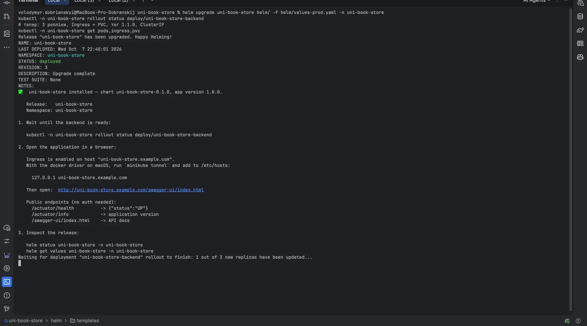

**8c — історія ревізій:**

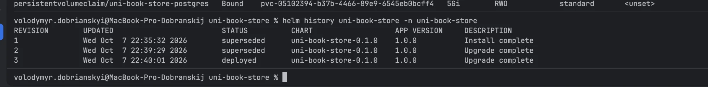

**8d — відкат:**

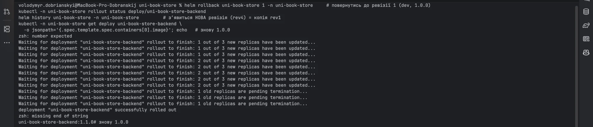

**8e — видалення релізу:**

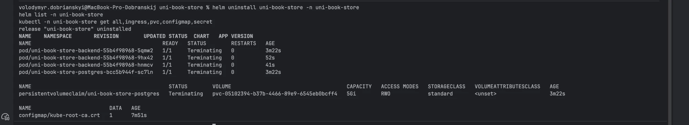

### 9a. Залежність від стороннього чарта (bitnami/postgresql)

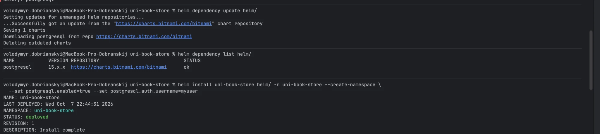
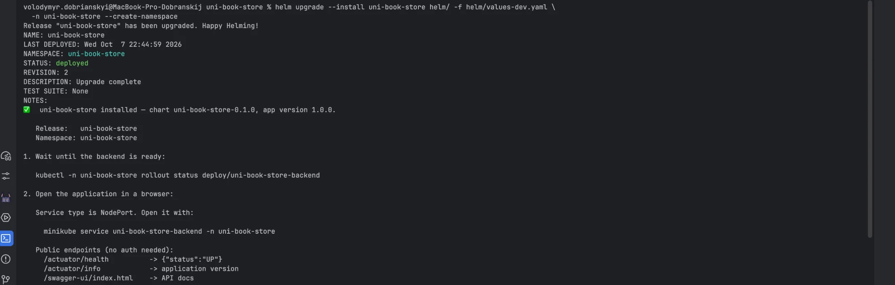
